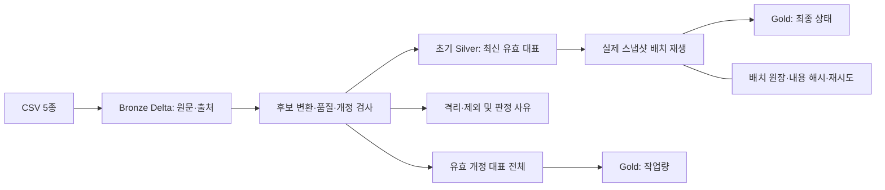

# KREAM 검수 데이터 파이프라인 — MySQL에서 Spark·Delta Lake로

**명세 기반 데이터 정제 경험을 Spark·Delta Lake로 확장하고, 개정 선택·배치 재시도·Gold 집계의 정합성을 검증한 프로젝트입니다.**

| 구분 | 기간 | 개인 수행 범위 |
| --- | --- | --- |
| 교육용 팀 프로젝트 | 2026.10.14~10.16 | MySQL Bronze → Silver 정제·적재, Gold 해석을 위한 검증·추론 |
| 이후 개인 학습 확장 | 2026.10.22 | Spark·Delta 초기 정제, 실제 Silver 배치 재생, 원장·재시도, 일별 Gold 검증 |

## 확인한 결과

- 원본 검수 **335,000행**을 정상 **271,787행**, 격리 **33,854행**, 제외 **29,359행**으로 분류했습니다.
- 실제 이전 유효 개정과 최신 Silver를 배치로 반영한 뒤, 초기 Spark Silver와 **업무·출처 전 컬럼 양방향 차이 0행**을 확인했습니다.
- Gold의 **최종 결과 271,787행**과 **유효 개정 작업량 291,548행**을 구분하고, 두 집계의 모든 행을 Python Decimal 계산과 대조했습니다.

앞의 분류 건수는 팀 저장 결과와도 일치합니다. 전 컬럼 대조는 **초기 Spark Silver와 배치 재생 Spark Silver 사이의 대조**이며 MySQL 최종 테이블 전체와의 값 일치 검증은 아닙니다. [실행 근거와 범위](extensions/delta-lake/docs/validation.md)

## 해결한 문제

원본에는 ID 표기 차이, 상품명 별칭, 금액·시간 단위 혼재, 잘못된 참조, 중복·개정 충돌이 섞여 있었습니다. 정상 값으로 보이는 결과만 남기면 오류의 원인과 이전 이력을 잃고, 같은 검수를 중복 집계할 수 있었습니다.

원문과 출처를 Bronze에 보존하고 변환 후보·실패 이유를 남겼습니다. 같은 개정의 원문 충돌은 격리하고, 품질을 통과한 개정 중 최신 대표를 선택했습니다. 현재 상태와 유효 작업 기록을 별도로 집계했습니다.

## 나의 기여와 팀 작업

| 범위 | 내용 |
| --- | --- |
| 팀 프로젝트 직접 담당 | MySQL 기반 Bronze → Silver 오염 데이터 정제·적재 |
| 팀 Gold 참여 | 결과 해석을 위한 데이터 검증과 추론 |
| 공동 수행 | 사전·모델링·분석·문서·발표 등 나머지 작업 |
| 다른 팀원 작성 | 기존 Pandas 분석 코드 |
| 이후 개인 확장 | Delta Lake 정제·배치 재생·Gold 집계 실습을 직접 실행하고 검사 결과 확인 |

기존 팀 프로젝트와 이후 개인 확장의 수행 범위를 구분했습니다. [개인 수행 범위와 구현 판단](extensions/delta-lake/docs/decisions.md)

## 처리 흐름

새 원본 CSV를 배치마다 정제하는 전체 증분 파이프라인은 아직 구현하지 않았습니다. 실제 배치 검증은 **정제 완료 스냅샷의 재생**입니다. [구현 구조](extensions/delta-lake/docs/architecture.md)

## 주요 기술과 검증한 판단

| 기술·판단 | 사용한 이유와 확인한 내용 |
| --- | --- |
| MySQL·SQL | 팀 프로젝트의 레이어별 정제·적재와 키·참조·계산 관계 검사 |
| PySpark 4.0.1·Delta Lake 4.0.0 | 기존 규칙을 DataFrame으로 재구현하고 저장 버전·MERGE·재시도를 실행 검증 |
| 업무 개정과 Delta 버전 구분 | REV_NO로 유효 개정을 선택하고 Delta 버전으로 저장 상태를 조회 |
| 원장 + MERGE | 완료 반복은 건너뛰고, 반영 후 완료 기록 전 중단은 같은 입력으로 재시도 |
| Decimal 대조 | 금액·시간 정밀도와 일별 집계 값 확인. 성능 개선 측정은 하지 않음 |

대표 사례: 같은 ID·개정인데 내용이 다르면 임의로 하나를 고르지 않습니다. 형식에 맞는 사번도 정상 마스터에 없으면 참조 실패로 남깁니다. 결측 카테고리 복구 후보 1,000행 중 격리 마스터를 참조한 29행은 정상으로 인정하지 않았습니다. [판단과 한계](extensions/delta-lake/docs/decisions.md)

## 코드·검증·실행 방법

- [Delta 개인 확장 안내](extensions/delta-lake/README.md)
- [개정·충돌과 초기 Silver 코드](extensions/delta-lake/lessons/08_revision_silver.py)
- [실제 데이터 배치 재생 코드](extensions/delta-lake/lessons/11_real_silver_replay.py)
- [최종 결과·유효 개정 작업량 Gold 코드](extensions/delta-lake/lessons/12_gold_daily.py)
- [실제 배치 검증 결과](extensions/delta-lake/results/lesson-11-latest.json) · [Gold 검증 결과](extensions/delta-lake/results/lesson-12-latest.json)
- [환경·입력·실행 순서](extensions/delta-lake/docs/reproduce.md) · [12개 실습의 검증 인덱스](extensions/delta-lake/evidence/verification-index.json)

원본 CSV는 공개하지 않습니다. 원본이 없으면 문서·코드·저장된 검사 요약을 열람할 수 있고, 실제 CSV 처리 전체를 재실행할 수는 없습니다. 학습용 소량 데이터와 실제 데이터 검증의 범위는 [검증 문서](extensions/delta-lake/docs/validation.md)에 구분했습니다.

## 기존 팀 프로젝트 자료

- [문제 진단과 MySQL 정제·적재](docs/data-processing.md)
- [팀 저장 검증 기록: Pandas 482개 검사 등](docs/validation.md)
- [Gold 해석의 분모·기간·제약](docs/analysis-interpretation.md)
- [원본·공개 범위와 출처](docs/data-and-scope.md) · [팀 집계 근거](evidence/README.md)
- [핵심 물리 ERD](assets/physical_erd.svg) · [팀 최종 발표자료](presentation/KREAM_최종발표자료.pptx)

팀의 Pandas 482개 검사 결과는 기존 산출물에 저장된 기록입니다. 개인 확장에서 이 482개 검사를 다시 실행한 것은 아닙니다.

## 한계와 다음 개선

새 원본 배치의 정제 증분, 모든 과거 개정의 충돌 재평가, 마스터 변경 대응, 동시 실행자 제어, Gold 증분 갱신은 남아 있습니다. 현재 배치 원장과 데이터 쓰기는 각각 별도 트랜잭션입니다. 외부 부작용까지 포함한 exactly-once 또는 다중 테이블 원자성을 주장하지 않습니다.

처리 속도·비용·정확도의 전후 개선을 비교 측정하지 않았습니다. 팀의 미검증 업무 조건과 상대 기준 차이도 그대로 남아 있습니다. [상세 검증 한계](extensions/delta-lake/docs/validation.md)

## 개발 도구 활용

개인 Delta Lake 확장의 구현·검사 코드와 문서 작성에 생성형 AI 지원을 활용했습니다. 각 단계를 로컬에서 직접 실행하고, Silver 전 컬럼 대조와 Gold 집계 검사의 결과를 확인했습니다. [개발 방식과 수행 범위](extensions/delta-lake/docs/decisions.md#개발-방식과-수행-범위)

## 출처

- [팀 공식 저장소](https://github.com/encore-ai-campus/mlo-02-p2-team4) — 신경호·장기욱·유성원
- KREAM 스타일의 합성 데이터를 사용한 교육 프로젝트이며 실제 기업 의뢰·운영 실적이 아닙니다.
- 팀의 기존 과거·실행 코드와 원본 CSV는 포함하지 않고, 개인 확장 예제·요약 결과를 구분해 구성했습니다. 새 라이선스는 부여하지 않았습니다.
