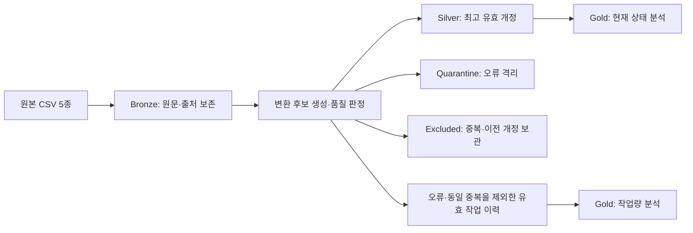
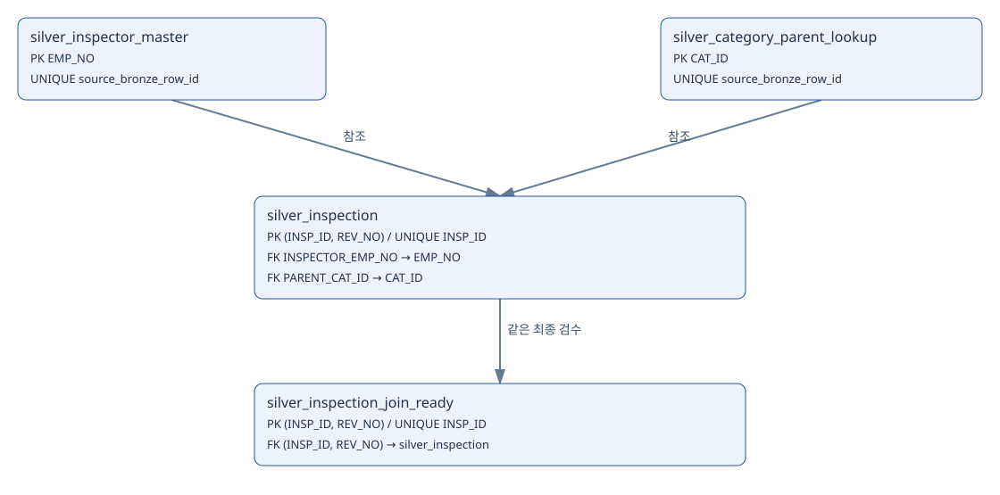

# KREAM 검수 데이터 정제·적재와 분석 검증

**오염된 검수 데이터를 MySQL의 Bronze·Silver 구조로 처리하고, 운영 분석에 사용할 수 있도록 정합성을 확인한 팀 프로젝트입니다.**

| 프로젝트 | 개인 담당 | 기간 |
| --- | --- | --- |
| 합성 검수 데이터 표준화와 운영 개선 분석 | MySQL 기반 Bronze → Silver 정제·적재, Gold 해석을 위한 검증·추론 | 2026.10.14~2026.10.16 |

## 해결한 문제

원천 검수 335,000행에는 ID 표기 차이, 상품명 별칭, 혼합된 금액·시간 단위, 잘못된 마스터 참조와 중복·개정 충돌이 섞여 있었습니다. 그대로 집계하면 같은 검수를 중복 계산하거나, 검수시간과 배상 위험을 잘못 해석할 수 있었습니다.

명세서와 공식 사전을 기준으로 복구 가능한 값은 표준화하고, 오류는 격리했습니다. 중복과 이전 유효 개정은 별도 보관해 현재 검수 상태와 작업 이력을 구분했습니다.

## 나의 역할

| 구분 | 수행 내용 |
| --- | --- |
| 직접 담당 | MySQL 기반 Bronze → Silver 구현, 오염 데이터 정제와 적재 |
| Gold 관련 기여 | 분석 결과 해석을 위한 데이터 검증과 추론 |
| 공동 수행 | 표준 사전·모델링·분석·문서·발표자료 등 나머지 작업 |
| 다른 팀원 작성 | Pandas 분석 코드 |

팀 전체 결과와 개인 담당 범위를 구분했습니다. Gold 구현 전체와 Pandas 분석 코드를 개인 단독 성과로 기재하지 않습니다.

## 핵심 결과

| 원본 검수 | 정상 Silver | 오류 격리 | 제외·보관 |
| ---: | ---: | ---: | ---: |
| 335,000행 | 271,787행 | 33,854행 | 29,359행 |

세 분류의 합계는 원본 335,000행과 일치합니다. 제외·보관은 동일 중복 9,598행과 이전 유효 개정 19,761행이며, 전부 오류 삭제를 의미하지 않습니다.

- **Pandas 검증 기록:** Silver·Gold 18개 테이블·188개 컬럼에 대한 482개 검사에서 실패 0개
- **SQL 품질 점검 기록:** 통과 14개, 미검증 1개, 상대팀 기준 차이 1개

위 수치는 팀 최종 산출물에 저장된 결과입니다. 이번 포트폴리오 정리 과정에서 전체 파이프라인을 재실행한 결과는 아니며, 모든 업무 규칙의 검증 완료를 뜻하지 않습니다. [검증 범위와 한계](docs/validation.md)

## 처리 구조

**개인 구현의 중심은 Bronze → Silver입니다.** Gold는 팀 산출물이며, 결과 해석에 필요한 분모와 집계 기준을 검토했습니다.

## 주요 처리와 판단

| 문제 | 적용한 처리 | 확인할 내용 |
| --- | --- | --- |
| ID·사번의 공백·전각 | 표기 정규화 후 형식·참조 검사 | 같은 식별자의 표기 차이와 실제 잘못된 참조 구분 |
| 금액·시간 단위 혼재 | 원화·분 단위 통일, 1달러 = 1,350원 적용 | 결측·음수·`-999`를 정상 수치로 보정하지 않음 |
| 날짜·시간대 문제 | KST 통일 후 입고 ≤ 완료 ≤ 추출 검사 | 변환 가능한 형식과 시간 순서 오류 구분 |
| 중복·동일 개정 충돌 | 충돌 격리, 유효 개정 선택, 이전 기록 보관 | 최신 상태와 실제 작업량의 목적 구분 |
| 마스터·배상금 불일치 | 이름 대신 사번 재조인, 배상금 재계산 | 동명이인과 잘못 붙은 마스터 정보의 전파 방지 |

[정제·적재 상세 사례](docs/data-processing.md)

## 데이터 모델

팀 최종 산출물의 핵심 물리 ERD입니다. 모든 Bronze·격리·제외·Gold 테이블을 포함한 전체 모델은 아닙니다. 상품 사전 조회 관계를 실제 DB 외래키와 혼동하지 않습니다.

## 사용 기술

| 기술 | 프로젝트에서 사용한 역할 |
| --- | --- |
| MySQL·SQL | 레이어별 테이블, 정제·적재, 키·참조·계산 관계 검사 |
| MySQL Workbench | 단계별 SQL 실행과 결과 확인 |
| Python·Pandas | 팀 공동 검증 및 다른 팀원이 작성한 분석 코드 |
| Matplotlib | 팀 분석 결과 시각화 |

## 상세 자료

- [문제 진단과 Bronze → Silver 처리](docs/data-processing.md)
- [검증 결과·미검증 항목·기준 차이](docs/validation.md)
- [Gold 분석의 분모와 해석 범위](docs/analysis-interpretation.md)
- [데이터·열람 범위와 출처](docs/data-and-scope.md)
- [수치 근거 파일 안내](evidence/README.md)
- [팀 최종 발표자료 다운로드](presentation/KREAM_최종발표자료.pptx)

## 한계와 후속 과제

점검 구간의 판정 조건이 없어 일부 규칙이 미검증으로 남았습니다. 상대팀이 제시한 분류 건수와의 차이도 추가 분석이 필요합니다. 부서 분석은 현재 마스터 소속 기준이므로 과거 소속이나 실제 재검수 담당자를 확정할 수 없습니다.

후속 과제는 분류 기준 차이의 원인 분석, 미검증 조건 확보, 검사 당시 소속·담당자 이력 보완입니다. 운영 개선안은 제안 단계이며 효과를 측정한 실적으로 표현하지 않습니다.

## 프로젝트 출처와 공개 범위

- [팀 공식 저장소](https://github.com/encore-ai-campus/mlo-02-p2-team4)
- 팀원: 신경호, 장기욱, 유성원
- KREAM 스타일의 합성 데이터를 사용한 교육용 프로젝트입니다. 실제 기업 의뢰·운영 실적을 의미하지 않습니다.
- 이 개인 포트폴리오는 설명 문서와 선별한 팀 산출물로 구성했습니다. 과거·실행 코드와 원본 CSV는 포함하지 않았습니다.
- 문서·이미지·집계 근거는 GitHub에서 열람하고, 발표자료는 내려받아 확인할 수 있습니다. 전체 파이프라인 재현용 저장소는 아닙니다.
