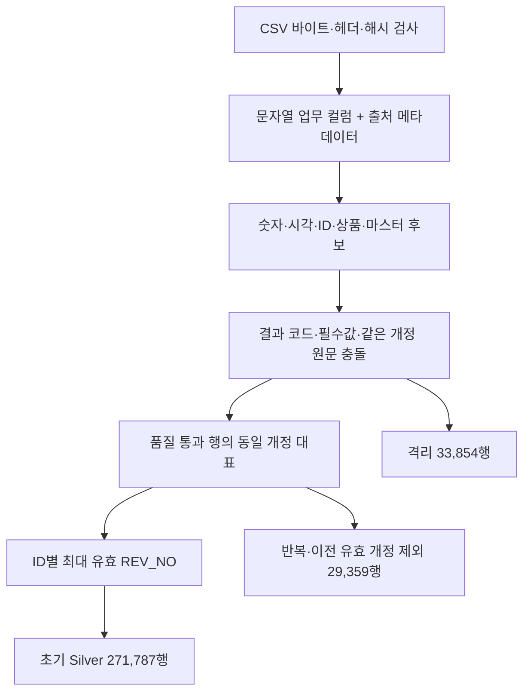

# 구현 구조와 데이터 흐름

## 입력과 실행 계보

원본은 KREAM 스타일의 합성 CSV 5종입니다. 파일명·해시·레코드 수는 저장소의 [원본 매니페스트](../../../evidence/source_manifest.csv)와 대조합니다. 제공 ZIP 안의 알려진 CSV만 읽고 원본을 수정하지 않습니다.

| 입력 | 레코드 수 | 용도 |
| --- | ---: | --- |
| 표준 사전 | 32 | 상품·별칭·금칙·결과·부서 기준 |
| 카테고리 마스터 | 1,050 | 카테고리 표기·계층·참조 검사 |
| 검수원 마스터 | 3,150 | 사번·부서·입사일·활성 표기 검사 |
| 검수 원천 | 335,000 | 정제·개정·최종 상태의 기준 |
| 제공 조인본 | 335,000 | 별도 Bronze로 보존 |

합계 674,232는 파일별 데이터 레코드를 더한 수입니다. 검수 원천과 조인본은 같은 검수의 서로 다른 표현일 수 있으므로 고유 검수 건수로 사용하지 않습니다. CSV 순번은 셀 내부 개행을 고려한 논리 레코드 번호입니다.

실행별 `run_id`로 데이터 경로를 분리하고 결과 JSON에 선행 실행 ID를 남깁니다. 선행 실습의 성공 요약에 연결된 경로를 읽으며, 수정되지 않은 후보·마스터는 버전 0을 사용합니다. Gold는 재생 Silver의 실행 시작 버전을 확인해 고정합니다.

## Bronze → 후보 → 초기 Silver

[02 Bronze](../lessons/02_bronze_ingestion.py)는 업무 값을 문자열로 보존합니다. 파일명·SHA-256·논리 레코드 순번·원본 식별자·배치·적재 시각을 추가합니다. 파싱된 셀 값과 파일 바이트를 구분하며 모두 확인합니다.

[03~07 후보 단계](../README.md)는 원문을 남긴 채 후보·상태·규칙 버전을 추가합니다. NULL 후보를 만드는 것과 원본 행의 격리·제외는 별개의 처리입니다. 사번·카테고리는 마스터 키 유일성을 확인한 후 LEFT JOIN하여 참조 실패도 보존합니다.

[08 초기 Silver](../lessons/08_revision_silver.py)의 충돌 키는 `(정규화 INSP_ID, REV_NO)`입니다. 원문 업무 11개 컬럼의 내용이 다르면 해당 개정 키를 격리합니다. 비교에는 추출 시각과 메모도 포함하며, 후보 값이 의미상 같다고 원문 충돌을 합치지는 않습니다.

품질을 통과한 동일 개정에서는 원본 레코드 번호가 가장 작은 행이 대표입니다. 검수 ID별로 대표 중 최대 유효 개정을 남깁니다. 최신 개정에 오류가 있으면 이전 정상 개정이 남을 수 있고, 추출 시각으로 최신 개정을 결정하지 않습니다.

## 실제 데이터의 배치 재생

[11 재생 코드](../lessons/11_real_silver_replay.py)는 초기 Silver의 정제 근거를 공유합니다. 실제 정상 이전 개정 19,761행을 먼저 넣고 최종 스냅샷 271,787행을 적용합니다. 실제 도착 순서의 복원이 아니라 제공 기록을 사용한 검증 순서입니다.

같은 ID의 더 높은 개정만 갱신하고 없는 ID는 추가합니다. 같은 현재 개정의 업무 컬럼 내용이 다르면 거부합니다. 완료 원장과 내용 해시가 일치하면 쓰기를 건너뛰고, STARTED이면 다시 반영한 뒤 완료를 기록합니다.

현재 스냅샷 반영은 갱신 19,761행·신규 252,026행으로 확인됐습니다. 완료 기록 직전 예외·재시도와 이전 개정의 지연 반영 후에도 초기 Spark Silver와 전 컬럼이 일치했습니다. [결과](../results/lesson-11-latest.json)

대상과 원장은 별도 Delta 테이블·별도 쓰기입니다. 단일 실행자, 입력 ID당 한 행, 선행 정제 완료를 전제로 합니다. 과거 모든 개정을 원장에 축적하거나 새 raw CSV의 충돌을 재평가하는 구현은 아닙니다.

## 두 Gold의 분모

[12 Gold](../lessons/12_gold_daily.py)는 완료일 KST 기준으로 두 테이블을 생성합니다.

| 테이블 | 입력 범위 | 주요 값 |
| --- | --- | --- |
| gold_inspection_result_daily | 최신 상태 271,787행 | 결과별 건수·거래금액·정책 배상금 |
| gold_inspection_workload_daily | 유효 개정 대표 291,548행 | 최초/재검수 기록 수·관측 사번 수·소요시간 합계·평균 |

작업량에는 정상 이전 개정 19,761행을 포함하되 동일 반복과 품질 오류는 제외합니다. REV_NO 1·2 이상을 최초·재검수 표기로 묶는 기존 정책을 따릅니다. 현재 상태와 작업 기록을 섞어 한 분모로 집계하지 않습니다.

골드 집계는 고정 스냅샷 전체 재집계입니다. 관측되지 않은 날짜를 0건으로 채우지 않습니다. 그룹별 고유 사번 수는 실제 출근 인원과 다르고, 거래금액은 매출이 아니며, 배상금은 실제 지급이 아닌 제공 정책 계산입니다.

## 저장과 공개 경계

코드·요약 JSON과 원본 해시 매니페스트를 열람 근거로 제공합니다. 원본 CSV, 전체 Bronze·Silver·Gold Delta 데이터, 캐시·가상환경, 학습 개인 노트는 공개 구성에서 제외합니다. [재현 조건](reproduce.md)
